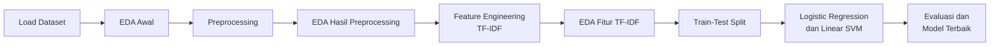

# PROJECT AKHIR PEMROSESAN TEKS KELOMPOK 10

# Sistem Deteksi Teks Buatan AI Menggunakan Metode Natural Language Processing

## Team Members

| Name | NIM |
|---|---|
| Yanaka Sofia Pardede | 24031554065 |
| Shakyla Andhara Chandraningtyas | 24031554199 |
| Annisa Ramadhani | 24031554206 |

**Dosen Pengampu:** Ike Fitriyaningsih, M.Si · Riskyana Dewi Intan Puspitasari, M.Kom.

## Project Overview

Model bahasa seperti GPT kini mampu menulis teks yang sulit dibedakan dari tulisan manusia. Kondisi ini menimbulkan tantangan baru, terutama bagi orisinalitas karya tulis di dunia pendidikan. Proyek ini membangun sistem klasifikasi biner yang membedakan **teks buatan manusia** dan **teks buatan AI** menggunakan pendekatan Natural Language Processing.

Teks diproses dengan NLTK (preprocessing), direpresentasikan dengan **TF-IDF** (unigram dan bigram), lalu diklasifikasikan menggunakan **Logistic Regression** dan **Linear SVM**. Hasil terbaik dicapai oleh **Linear SVM dengan accuracy 95,45%**.

### Tujuan

1. Melakukan preprocessing dan pembersihan data teks untuk deteksi teks buatan AI.
2. Mengekstraksi fitur yang dapat membedakan teks manusia dan teks AI.
3. Membangun sistem NLP yang mampu mendeteksi teks buatan AI.
4. Mengevaluasi kinerja model yang dilatih.

## Dataset Information

- **Dataset:** HC3 (Human–ChatGPT Comparison Corpus)
- **Source:** [Hello-SimpleAI/HC3 (Hugging Face)](https://huggingface.co/datasets/Hello-SimpleAI/HC3)
- **File yang dipakai:** `hc3_binary_classification.csv`
- **Total Records:** 85,449
- **Attributes:** `question`, `answer`, `label`
- **Language:** English

| Label | Jumlah | Proporsi |
|---|---:|---:|
| human | 58,546 | 68,5% |
| ai | 26,903 | 31,5% |

**Kondisi data**

- Missing value: 18 baris pada kolom `answer` (diisi string kosong saat preprocessing)
- Data duplikat: 3,019 baris (tidak dihapus)
- Distribusi label **tidak seimbang** (human sekitar 2 kali lebih banyak dari AI)

> File dataset tidak diunggah ke repository. Unduh dari sumber di atas, lalu sesuaikan path pada notebook.

## Workflow



## Text Preprocessing

| Step | Description |
|---|---|
| Lowercase | Menyamakan seluruh huruf menjadi huruf kecil |
| Punctuation & symbol removal | Mengganti karakter selain huruf dengan spasi (`[^a-zA-Z\s]`) |
| Normalization | Merapikan spasi ganda dan spasi di awal/akhir |
| Tokenization | Memecah teks menjadi token kata |
| Stopword removal | Menghapus stopword bahasa Inggris (NLTK) |
| Lemmatization | Mengubah kata ke bentuk dasar dengan `WordNetLemmatizer` |
| Rejoin tokens | Menggabungkan token menjadi teks bersih (`cleaned`) |

Kolom tambahan: `raw_length` dan `clean_length` (jumlah kata sebelum dan sesudah preprocessing).

## Feature Engineering (TF-IDF)

| Parameter | Value |
|---|---|
| `max_features` | 5000 |
| `ngram_range` | (1, 2) |
| `min_df` | 2 |

| Hasil | Nilai |
|---|---|
| Ukuran matriks | 85,449 × 5,000 |
| Vocabulary size | 5,000 |
| Sparsity | 99,14% |

## Modeling

| Item | Value |
|---|---|
| Data splitting | 80% train (68,359) : 20% test (17,090) |
| Stratify | Ya (berdasarkan label) |
| Random state | 42 |
| Model 1 | Logistic Regression (`max_iter=2000`) |
| Model 2 | Linear SVM / LinearSVC (parameter default) |
| Kriteria model terbaik | Accuracy pada data uji |

## Exploratory Data Analysis

### Sebelum preprocessing

- Sebagian besar jawaban relatif pendek (distribusi panjang teks sangat miring ke kanan).
- Pada teks mentah, teks human memuat lebih banyak tanda baca (titik dan koma masuk 10 kata teratas), sedangkan teks AI terlihat lebih bersih.

### Setelah preprocessing

| | Kata dominan |
|---|---|
| WordCloud Human | people, think, use, time |
| WordCloud AI | example, use, mean, important |
| Top 20 Human | n, like, one, would, people, get, time, make, thing, also |
| Top 20 AI | may, also, people, help, important, make, use, way, used, time |

Kata dengan skor TF-IDF rata-rata tertinggi: people, like, would, one, get, time, make, also, may, url.

## Results

### Model Evaluation (data uji, 17,090 baris)

| Model | Accuracy | Precision (macro) | Recall (macro) | F1-Score (macro) |
|---|---:|---:|---:|---:|
| Logistic Regression | 94,59% | 0,94 | 0,93 | 0,94 |
| **Linear SVM** | **95,45%** | **0,95** | **0,94** | **0,95** |

### Per Kelas

| Model | Kelas | Precision | Recall | F1-Score | Support |
|---|---|---:|---:|---:|---:|
| Logistic Regression | ai | 0,94 | 0,89 | 0,91 | 5,381 |
| Logistic Regression | human | 0,95 | 0,97 | 0,96 | 11,709 |
| Linear SVM | ai | 0,94 | 0,92 | 0,93 | 5,381 |
| Linear SVM | human | 0,96 | 0,97 | 0,97 | 11,709 |

### Confusion Matrix

| | Logistic Regression | Linear SVM |
|---|---:|---:|
| AI diprediksi AI (benar) | 4,768 | 4,937 |
| AI diprediksi Human (salah) | 613 | 444 |
| Human diprediksi AI (salah) | 311 | 333 |
| Human diprediksi Human (benar) | 11,398 | 11,376 |
| **Total kesalahan** | **924** | **777** |

- **Best Model:** Linear SVM

## Key Findings

- Teks human dan teks AI memiliki karakteristik yang berbeda, baik dari pola kata maupun penggunaan tanda baca. Teks AI cenderung lebih formal dan informatif, sedangkan teks human lebih bebas dan bervariasi.
- Matriks TF-IDF sangat sparse (99,14%), sehingga model linear seperti Logistic Regression dan Linear SVM cocok digunakan.
- Kedua model berkinerja baik, dan Linear SVM unggul tipis dari Logistic Regression (95,45% vs 94,59%).
- Linear SVM menghasilkan lebih sedikit kesalahan, terutama pada kelas AI (444 vs 613 teks AI yang salah dikenali sebagai human).
- Kedua model lebih kuat mengenali teks human dibandingkan teks AI. Hal ini sejalan dengan jumlah data human yang lebih banyak.
- Sebagai pembanding, menebak seluruh teks sebagai human hanya akan menghasilkan accuracy sekitar 68,5%, sehingga kedua model jauh di atas baseline tersebut.

## Limitations & Future Work

- **Data tidak seimbang.** Perlu penanganan seperti class weight atau resampling, dan evaluasi sebaiknya tidak hanya bergantung pada accuracy.
- **TF-IDF dilatih pada seluruh data sebelum split.** Idealnya vectorizer di-*fit* hanya pada data latih agar tidak ada kebocoran informasi ke data uji.
- **Data duplikat (3,019 baris) belum dihapus**, sehingga sebagian teks yang sama bisa muncul di data latih dan data uji.
- **Artefak teks.** Token `n` kemungkinan berasal dari potongan kata seperti `n't` setelah tanda baca dihapus, dan `url` adalah penanda pada dataset. Keduanya masuk ke daftar kata teratas.
- Penghapusan tanda baca dan huruf kapital dapat membuang ciri gaya penulisan yang justru membedakan human dan AI.
- Dataset berbahasa Inggris dan berasal dari ChatGPT, sehingga hasil belum tentu berlaku untuk bahasa lain atau model AI lain.
- Pengembangan lanjutan: ROC untuk kedua model, fitur tambahan (panjang teks, tanda baca), tuning hyperparameter, dan model berbasis deep learning.

## How to Run

1. Buka `notebook/KODE_PROYEK_PEMTEKS_KEL_10.ipynb` di Google Colab.
2. Unggah dataset ke Google Drive, lalu ubah variabel `BASE` dan `DATASET_PATH` pada bagian Set Folder Path.
3. Jalankan seluruh sel secara berurutan.

Untuk menjalankan di lokal, hapus sel `drive.mount` dan pasang library:

```bash
pip install pandas numpy matplotlib seaborn nltk scikit-learn wordcloud
```

> Notebook menyimpan `cleaned_dataset.csv` dan `tfidf_features.csv` ke folder output. Kedua file berukuran besar, sehingga tidak disertakan di repository.
**PROJECT AKHIR PEMROSESAN TEKS – KELOMPOK 10**  
S1 Sains Data | Fakultas Matematika dan Ilmu Pengetahuan Alam | Universitas Negeri Surabaya  
Semester Gasal 2025/2026
